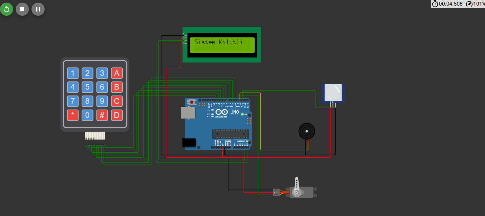

# 🔐 RTOS-Based Secure Access Control and Intrusion Detection System

## 📌 Overview

This project is an embedded security system developed using Arduino and FreeRTOS. It combines password-based access control with PIR-based motion detection to manage a servo-controlled lock and detect potential intrusion attempts.

The system uses multiple RTOS tasks to handle access control, intrusion detection, and event logging concurrently.

## ✨ Features

- 🔑 **Password-Based Access Control:** Enter a four-digit PIN using a 4×4 keypad.
- 🔒 **Servo-Controlled Lock:** Unlocks when the correct PIN is entered and automatically locks again after five seconds.
- 🚨 **Intrusion Detection:** Detects motion using a PIR sensor while the system is locked.
- 🔊 **Audible Alarm:** Activates a buzzer when motion is detected in the locked state.
- 🖥️ **LCD Interface:** Displays access status and password-related messages on a 16×2 LCD.
- 📋 **Event Logging:** Records successful access, incorrect password attempts, and motion detection events through the Serial Monitor.
- ⚙️ **Real-Time Task Management:** Uses FreeRTOS tasks, a queue, and a mutex for task coordination and shared-state protection.

## 🛠️ Hardware Components

- Arduino-compatible microcontroller
- PIR motion sensor
- 4×4 matrix keypad
- 16×2 I2C LCD
- Servo motor
- Buzzer
- Jumper wires and breadboard

## 💻 Software & Technologies

- **C/C++** — Embedded application logic
- **Arduino** — Hardware programming platform
- **FreeRTOS** — Real-time multitasking
- **Arduino_FreeRTOS** — FreeRTOS integration for Arduino
- **LiquidCrystal_I2C** — LCD control
- **Keypad** — Matrix keypad input
- **Servo** — Servo motor control

## ⚙️ System Architecture

The application consists of three main RTOS tasks:

| Task | Responsibility |
|---|---|
| `TaskAccessControl` | Reads keypad input, validates the PIN, and controls the lock |
| `TaskIntrusionDetection` | Monitors the PIR sensor and activates the alarm when motion is detected while locked |
| `TaskLogger` | Processes queued events and prints log messages to the Serial Monitor |

A FreeRTOS queue is used to transfer event codes to the logging task, while a mutex protects access to the shared lock-state variable.

## 🔄 How It Works

1. The system starts in the locked state.
2. The user enters a four-digit PIN using the keypad.
3. If the PIN is correct, the servo unlocks the system for five seconds before relocking.
4. If the PIN is incorrect, the LCD displays an error message and the event is logged.
5. While the system is locked, the PIR sensor monitors for movement.
6. If movement is detected, the buzzer sounds and an intrusion event is logged.
7. The logging task processes events received through the FreeRTOS queue.

**Default PIN:** `1234`

*Note: The default PIN is hardcoded in the current implementation and should be changed or secured before real-world deployment.*

## 📷 Circuit Setup

The following image shows the hardware setup of the access control and intrusion detection system.

## 🎥 Demo

Watch the demonstration video to see the system's access control, motion detection, alarm, and logging functionality in action.

[▶️ Watch the Demo Video](https://www.youtube.com/watch?v=IcdJoe5XlD4)

## 🚀 Setup and Usage

1. Install the Arduino IDE.
2. Install the required libraries:
   - Arduino_FreeRTOS
   - LiquidCrystal_I2C
   - Servo
   - Keypad
3. Connect the hardware components according to the circuit setup.
4. Open the Arduino source file and upload the code to the compatible board.
5. Open the Serial Monitor at **9600 baud** to view system logs.
6. Enter the PIN `1234` to test the access control functionality.

## 🎯 Project Objectives

- Apply real-time operating system concepts to an embedded security application.
- Implement concurrent tasks for access control, intrusion detection, and event logging.
- Explore synchronization and inter-task communication using FreeRTOS primitives.
- Integrate sensors, actuators, and a user interface into a functional security prototype.

## 👨‍💻 Project Category

**Embedded Systems | FreeRTOS | Arduino | Access Control | Intrusion Detection**
